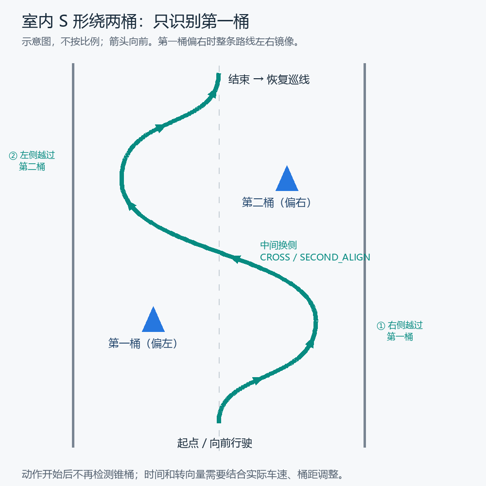

# 室内：识别一次，S形绕过两桶

室内停车最新改为选定挡板反侧并持续沿该侧边线，参数 `parking_follow_pwm` / `parking_edge_margin_fraction`，详见 [室内沿边停车](README.indoor_parking_edge.md)。旧的定时绕板与回中说明不适用于当前室内配置。

只识别第一个锥桶，确认并达到 `cone_avoid_start_y`（当前保留300像素）后开始整套S形；中间不检测第二桶，也不要求第一桶消失。结束进入 `S_DONE` 并恢复正常巡线，本次启动不再触发锥桶动作。需要重新练习时退出并重启。

## 路线示意

以下是“第一个桶偏左、第二个桶偏右”的概念路线，行进方向向上，不按比例，也不是实际车辆轨迹预测：



实际顺序是：中间起步 → 到右边绕过第一桶 → 转向左边绕过第二桶 → 回到中间并摆正 → 巡线。第一个桶偏右时整条路线自动左右镜像。两桶必须按相反侧摆放；第二桶的位置不再实时观测。

## 配置入口

修改 `/home/pi/yidui/jgy/race_suite_outdoor_v2/config/indoor.yaml` 末尾的 `cone_s_steps`。已启用：

```yaml
cone_fixed_maneuver: 1
cone_s_course_once: 1
cone_fixed_side: 0  # 0按第一个桶选反侧；1首次右绕；-1首次左绕
cone_s_steps:
  - { name: FIRST_OUT,    steer:  5.0, seconds: 0.65, motor_pwm: 10900 }
  - { name: FIRST_ALIGN,  steer: -5.0, seconds: 0.65, motor_pwm: 10900 }
  - { name: FIRST_PASS,   steer:  0.0, seconds: 0.45, motor_pwm: 10900 }
  - { name: CROSS,        steer: -5.0, seconds: 0.95, motor_pwm: 10900 }
  - { name: SECOND_ALIGN, steer:  5.0, seconds: 0.95, motor_pwm: 10900 }
  - { name: SECOND_PASS,  steer:  0.0, seconds: 0.45, motor_pwm: 10900 }
  - { name: RETURN,       steer:  5.0, seconds: 0.65, motor_pwm: 10900 }
  - { name: FINAL_ALIGN,  steer: -5.0, seconds: 0.65, motor_pwm: 10900 }
  - { name: SETTLE,       steer:  0.0, seconds: 0.20, motor_pwm: 10900 }
```

总指令时长5.6秒，未计红灯/斑马线停车和每帧切换延迟。它是供实跑调整的起点；“小于3米”不能确定准确时间，实际还取决于两桶间距、车速、舵机和起绕位置。

| 段名 | 动作目的 | 主要调什么 |
|---|---|---|
| FIRST_OUT | 从第一桶反侧转出 | `steer`绝对值和`seconds`影响转出幅度 |
| FIRST_ALIGN | 反打，在第一桶旁摆正 | 调到车头大致与车道平行 |
| FIRST_PASS | 在第一桶旁直行 | 控制何时开始跨向第二桶另一侧，过短会没过第一桶就回切 |
| CROSS | 横向跨向另一边 | 和SECOND_ALIGN共同决定S形中间的横向跨度 |
| SECOND_ALIGN | 在第二桶另一侧摆正 | 调到车头朝前，避免继续朝边界冲 |
| SECOND_PASS | 直行越过第二桶 | 过短会提前向第二桶回切，过长会拖后回中 |
| RETURN | 第二桶后朝中间回转 | 控制回中幅度 |
| FINAL_ALIGN | 反打，把车头摆正 | 控制交还巡线前的朝向 |
| SETTLE | 舵机回正短直行 | 平稳交还巡线，不参与闭环找中线 |

`steer` 正数朝**首次选定的绕行侧**，负数反向，0舵机回正；执行到第二桶时不重新定义正负方向。它是PWM修正，不是角度。当前目标为 `80 - side*steer`，限位55..86：向左最大只能到86，所以大于6的左向修正仍被限幅。直行段回正只保持当前车头朝向，不会自动修正车身偏航。

`seconds` 是本段前进命令持续秒数；每段大于0、不超过15秒，最多20段，总计不超过60秒。删除不需要的段，不要用0秒。`motor_pwm` 是每段独立油门，须大于当前停车中位10000且不超过12000。机械限位、红灯与斑马线优先级保留，交通停车期间暂停动作计时。

## 建议调参顺序

1. 固定两桶摆放和首次识别的起绕位置；`cone_avoid_start_y` 越小越早开始。保持同一油门先调，避免速度与时间同时变化。
2. 先调 FIRST_OUT/FIRST_ALIGN，使车在第一桶反侧通过并摆正。避让不足可增加转出幅度或时间；靠边过多则减小。
3. 调 FIRST_PASS 决定切向第二桶的时机，再成对调 CROSS/SECOND_ALIGN 的横移与摆正。两桶越近，通常越需要提早开始中间换侧；不能只把整套动作时间同比缩短。
4. 调 SECOND_PASS，保证越过第二桶后才回中；再调 RETURN/FINAL_ALIGN，使交还巡线时车头朝前、位置接近中间。
5. 每次只改一处或一对配合段，时间可先按0.05～0.10秒小步调整。重新启动后观察相同起点的结果。

## 启动和日志

```bash
cd /home/pi/yidui/jgy/race_suite_outdoor_v2
sh run_indoor.sh --modules lane,cone --check-config
# 实车巡线 + 一次完整S形，无预览
sudo sh run_indoor.sh --modules lane,cone --enable-motion
# 全部模块：S形完成后启用停车
sudo sh run_indoor.sh --modules all --enable-motion
```

驾驶时仍默认禁用预览。保存 YAML 后退出、重启生效，不用重新编译。日志如 `CONE_S_RIGHT_1_FIRST_OUT` 表示首次向右绕的第1段；`fixed_remaining_s` 是本段剩余时间。结束后 `cone: S_DONE`，普通行驶为 `state: RUN`（交通停车等更高优先级任务仍可接管）。`passed: 1` 表示完成一次整套S路线，不是视觉确认了两桶；S模式的停车解锁直接看整套完成，不使用 `parking_after_cones`。

室外配置未开启 `cone_s_course_once`，保留逐桶模式；室内停车使用 parking_follow_pwm 与 parking_edge_margin_fraction 持续沿边线，不与S形共用参数。无编码器或IMU角度闭环，动作时长与指令验证不能代替现场通过验证。
